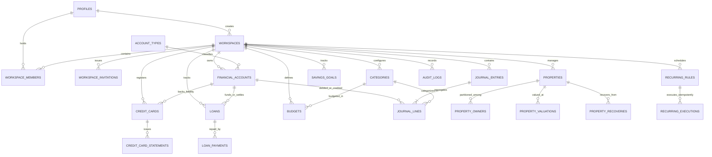

# Power of Money — Complete Database Architecture & Engineering Specification

## 1. Executive Architecture Summary

"Power of Money" is designed as a high-fidelity, production-grade financial operating system for individuals and families.
At its foundation lies an immutable, double-entry financial ledger enforcing strict conservation of money:
$$\sum \text{Debits} = \sum \text{Credits}$$

All financial positions are derived from atomic journal entries or synchronized high-integrity cached balances. Floating-point arithmetic is strictly prohibited; all monetary amounts use exact `NUMERIC(20, 2)`.

---

## 2. Complete Entity-Relationship (ER) Diagram

---

## 3. Comprehensive Table Dictionary

### 3.1 Core Workspaces & Access Control
| Table | Column | Type | Constraints | Description |
|---|---|---|---|---|
| `profiles` | `id` | `UUID` | PK, REFERENCES auth.users | Extended user identity profile |
| `profiles` | `email` | `TEXT` | NOT NULL | User primary email |
| `profiles` | `full_name` | `TEXT` | NOT NULL | Display name |
| `profiles` | `default_currency`| `TEXT` | NOT NULL DEFAULT 'BDT' | Default currency code |
| `workspaces` | `id` | `UUID` | PK, gen_random_uuid() | Workspace tenant identifier |
| `workspaces` | `name` | `TEXT` | NOT NULL | Name (e.g. "Personal Workspace", "Khan Family") |
| `workspaces` | `type` | `TEXT` | CHECK ('personal', 'family') | Workspace tenant isolation model |
| `workspaces` | `created_by` | `UUID` | REFERENCES profiles(id) | Creator of workspace |
| `workspaces` | `currency` | `TEXT` | DEFAULT 'BDT' | Base operating currency |
| `workspace_members` | `id` | `UUID` | PK | Membership link |
| `workspace_members` | `workspace_id`| `UUID` | REFERENCES workspaces(id) | Associated workspace |
| `workspace_members` | `user_id` | `UUID` | REFERENCES profiles(id) | Associated user |
| `workspace_members` | `role` | `TEXT` | 'owner', 'admin', 'editor', 'viewer' | RBAC role |
| `workspace_members` | `permissions`| `JSONB` | Granular module permissions | Fine-grained module toggles |
| `workspace_members` | `status` | `TEXT` | 'active', 'invited', 'revoked' | Membership lifecycle state |
| `workspace_invitations`| `token` | `TEXT` | UNIQUE, 32-byte hex | Secure invitation token |
| `audit_logs` | `action` | `TEXT` | NOT NULL | Action (e.g. POST_ENTRY, REVERSAL) |

### 3.2 Double-Entry Accounting Ledger
| Table | Column | Type | Constraints | Description |
|---|---|---|---|---|
| `account_types` | `id` | `TEXT` | PK | Machine key (e.g. cash, bank, mfs, credit_card) |
| `account_types` | `classification`| `TEXT` | asset, liability, equity, income, expense | Fundamental accounting classification |
| `account_types` | `normal_balance`| `TEXT` | debit, credit | Standard balance sign convention |
| `financial_accounts` | `id` | `UUID` | PK | Account identifier |
| `financial_accounts` | `workspace_id` | `UUID` | REFERENCES workspaces(id) | Scoped workspace |
| `financial_accounts` | `name` | `TEXT` | NOT NULL | e.g. "BRAC Bank Salary", "bKash Primary" |
| `financial_accounts` | `provider` | `TEXT` | Cash, bKash, Nagad, BRAC Bank, etc. | Institution / Platform provider |
| `financial_accounts` | `account_number_masked` | `TEXT` | Optional e.g. '•••• 9482' | Safe non-sensitive display identifier |
| `financial_accounts` | `opening_balance` | `NUMERIC(20,2)` | NOT NULL DEFAULT 0.00 | Initial baseline balance |
| `financial_accounts` | `current_balance_cached` | `NUMERIC(20,2)` | Atomic double-entry cache | High-performance synced balance |
| `journal_entries` | `id` | `UUID` | PK | Journal entry header ID |
| `journal_entries` | `entry_number` | `BIGINT` | GENERATED ALWAYS AS IDENTITY | Monotonic sequential transaction number |
| `journal_entries` | `entry_date` | `DATE` | NOT NULL | Transaction calendar date |
| `journal_entries` | `memo` | `TEXT` | NOT NULL | Accounting description |
| `journal_entries` | `status` | `TEXT` | draft, posted, voided, reversed | Ledger state |
| `journal_entries` | `reversal_of_entry_id` | `UUID` | REFERENCES journal_entries | Linked original transaction if reversal |
| `journal_lines` | `id` | `UUID` | PK | Line item ID |
| `journal_lines` | `journal_entry_id` | `UUID` | REFERENCES journal_entries | Parent journal header |
| `journal_lines` | `account_id` | `UUID` | REFERENCES financial_accounts | Debited or credited account |
| `journal_lines` | `line_type` | `TEXT` | 'debit' or 'credit' | Double-entry side |
| `journal_lines` | `amount` | `NUMERIC(20,2)` | CHECK (amount > 0) | Exact non-negative amount |

### 3.3 Cards, Loans, Properties, Goals & Budgets
- `credit_cards`: Tracks card accounts, limits, statement cut-offs, due days, and APR.
- `loans`: Tracks money borrowed (liability) vs money lent (receivable).
- `loan_payments`: Distinguishes principal payments from interest expense.
- `properties`: Tracks real estate, agricultural land, ponds, with exact original size (e.g. "75 Khara", "20/4 Khara", "N/A") and raw ownership share (e.g. "6 Ana", "3 Share", "Mass Share", "50%").
- `property_valuations`: Multi-date market valuations vs ownership-adjusted value.
- `property_recoveries`: Tracks amounts recovered from disputed/shared estates, reducing recovery receivables without inflating income.
- `categories`: Master classification including the 36 seed categories with accurate financial semantics.
- `budgets`: Category spending limits with alert thresholds.
- `savings_goals`: DPS and savings goals with maturity targets.
- `recurring_rules` & `recurring_executions`: Idempotent scheduled transactions with unique occurrence identifiers.

---

## 4. Fundamental Accounting Rules Enforced by the System

1. **Credit Card Payments**:
   - $\text{Debit: Credit Card Liability Account}$ (decreases liability)
   - $\text{Credit: Bank Account}$ (decreases liquid asset)
   - *Result*: Zero expense recognized. Eliminates duplicate expense recording.

2. **Money Borrowed**:
   - $\text{Debit: Bank / Cash Account}$ (increases asset)
   - $\text{Credit: Loan Payable Account}$ (increases liability)
   - *Result*: Zero income recognized.

3. **Loan Repayments**:
   - $\text{Debit: Loan Payable Account}$ (reduces liability by principal paid)
   - $\text{Debit: Interest Expense Account}$ (records true interest cost)
   - $\text{Credit: Bank Account}$ (total cash outflow)
   - *Result*: Principal is not counted as an operating expense.

4. **Money Lent to Others**:
   - $\text{Debit: Loan Receivable Account}$ (creates asset)
   - $\text{Credit: Cash / Bank Account}$ (reduces liquid asset)
   - *Result*: Not an operating expense.

5. **Borrower Repayments Received**:
   - $\text{Debit: Cash / Bank Account}$ (increases cash)
   - $\text{Credit: Loan Receivable Account}$ (reduces receivable)
   - *Result*: Not new earned income.

6. **Property Recoveries**:
   - $\text{Debit: Bank / Cash Account}$
   - $\text{Credit: Property Recovery Receivable / Asset Account}$
   - *Result*: Reduces remaining recovery balance; never double-counted as property income.

---

## 5. Migration Execution Guide for Supabase

Execute the migration files located in `/supabase/migrations/` in order:

1. `20261031000001_core_schema.sql`
2. `20261031000002_accounting_ledger.sql`
3. `20261031000003_banking_cards_loans.sql`
4. `20261031000004_property_register.sql`
5. `20261031000005_budgets_savings_recurring.sql`
6. `20261031000006_accounting_functions_and_rpc.sql`
7. `20261031000007_rls_and_storage_policies.sql`
8. `20261031000008_security_and_integrity_tests.sql`

All scripts are idempotent (`IF NOT EXISTS`, `ON CONFLICT DO NOTHING`).
